# Bank Account Microservice


## Table des matières

1. [Architecture et modèle de données](#3-architecture-et-modèle-de-données)
2. [Structure du projet](#4-structure-du-projet)
3. [Installation et lancement](#5-installation-et-lancement)
4. [API REST (Spring Data REST)](#6-api-rest-spring-data-rest)
5. [Documentation Swagger / OpenAPI](#7-documentation-swagger--openapi)
6. [API GraphQL](#8-api-graphql)
7. [Synthèse des tests](#9-synthèse-des-tests)
8. [Axes d'amélioration](#10-axes-damélioration)


---

## 1. Architecture et modèle de données

### 1.1 Entités

**BankAccount**

| Champ | Type | Description |
|---|---|---|
| `id` | `String` (UUID) | Identifiant unique, généré automatiquement |
| `createdAt` | `Date` | Date de création du compte |
| `balance` | `Double` | Solde du compte |
| `currency` | `String` | Devise (MAD, USD, etc.) |
| `type` | `Enum` | `CURRENT_ACCOUNT` ou `SAVING_ACCOUNT` |
| `customer` | `Customer` | Client propriétaire du compte |

**Customer**

| Champ | Type | Description |
|---|---|---|
| `id` | `Long` | Identifiant du client |
| `name` | `String` | Nom du client |
| `bankAccounts` | `List<BankAccount>` | Comptes détenus par le client |


## 2. Structure du projet

```
bank-account-ms
|-- .mvn/wrapper/            Maven Wrapper
|-- src/
|   |-- main/
|   |   |-- java/            Entités, repositories, contrôleurs GraphQL
|   |   `-- resources/       Configuration et schéma GraphQL
|                 
|-- docs/
|   `-- screenshots/         Captures d'écran des tests
|-- pom.xml
|-- mvnw / mvnw.cmd
`-- README.md
```


## 3. API REST (Spring Data REST)

URL de base : `http://localhost:8081/bankAccounts`

| Méthode | Endpoint | Description |
|---|---|---|
| `GET` | `/bankAccounts` | Liste de tous les comptes |
| `GET` | `/bankAccounts/{id}` | Détail d'un compte |
| `POST` | `/bankAccounts` | Création d'un compte |
| `PUT` | `/bankAccounts/{id}` | Mise à jour d'un compte |
| `DELETE` | `/bankAccounts/{id}` | Suppression d'un compte |

### 3.1 Consultation de la liste des comptes (GET)

```http
GET http://localhost:8081/bankAccounts
```

Le serveur répond avec le code `200 OK` et la liste des comptes au format JSON.

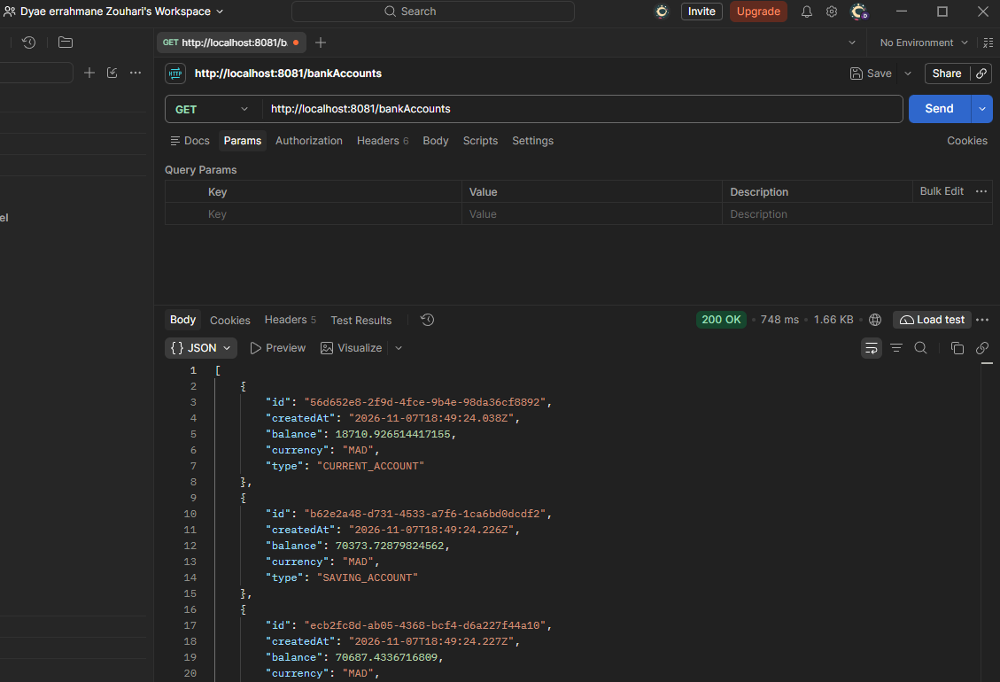

*Figure 1 - Récupération de la liste des comptes avec Postman.*

### 3.2 Création d'un compte (POST)

```http
POST http://localhost:8081/bankAccounts
Content-Type: application/json

{
  "balance": 18710.926514417155,
  "currency": "MAD",
  "type": "CURRENT_ACCOUNT"
}
```

Le serveur retourne le compte créé, avec son identifiant généré.

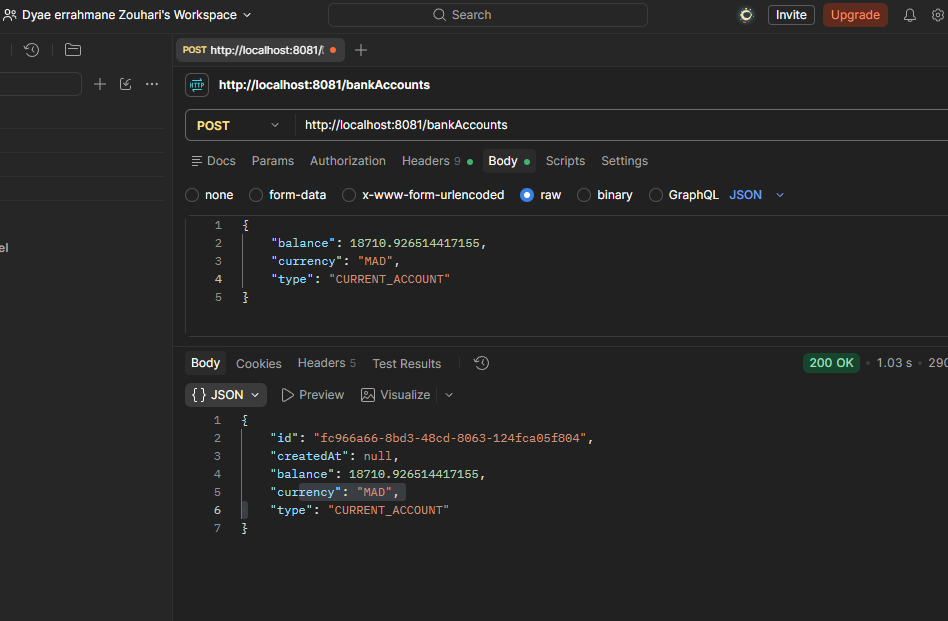

*Figure 2 - Création d'un compte courant avec Postman.*


### 3.3 Modification d'un compte (PUT)

```http
PUT http://localhost:8081/bankAccounts/fc966a66-8bd3-48cd-8063-124fca05f804
Content-Type: application/json

{
  "currency": "USD"
}
```

Seul le champ `currency` est modifié (de `MAD` vers `USD`) ; les autres champs sont conservés.

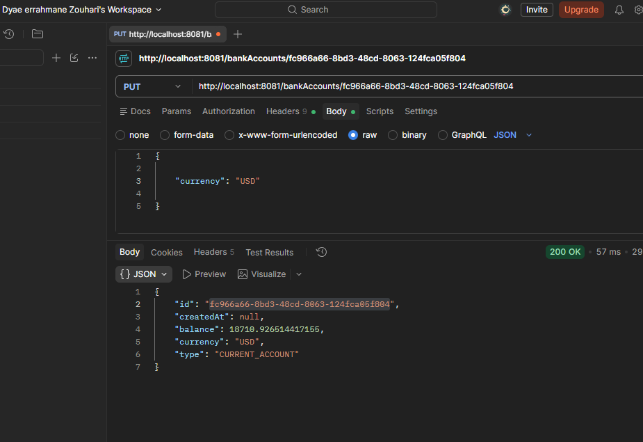

*Figure 3 - Modification de la devise d'un compte avec Postman.*

---

## 4. Documentation Swagger / OpenAPI

La documentation interactive est générée par springdoc-openapi et disponible à l'adresse suivante :

```
http://localhost:8081/swagger-ui/index.html
```

Elle permet de tester chaque endpoint depuis le navigateur et fournit la commande `curl` équivalente :

```bash
curl -X 'GET' \
  'http://localhost:8081/bankAccounts' \
  -H 'accept: */*'
```

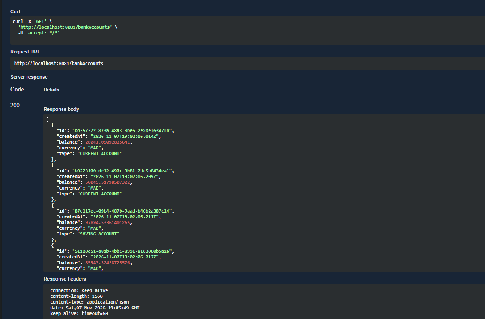

*Figure 4 - Exécution de la requête GET dans Swagger UI.*

---

## 5. API GraphQL

Endpoint : `http://localhost:8081/graphql`
Interface de test : `http://localhost:8081/graphiql?path=/graphql`

### 5.1 Requêtes (queries)

#### Liste des comptes (identifiants)

```graphql
query {
  accountsList {
    id
  }
}
```

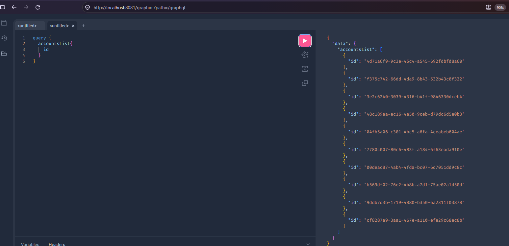

*Figure 5 - Liste des identifiants de comptes.*

#### Liste des comptes avec solde et devise

```graphql
query {
  accountsList {
    id
    balance
    currency
  }
}
```

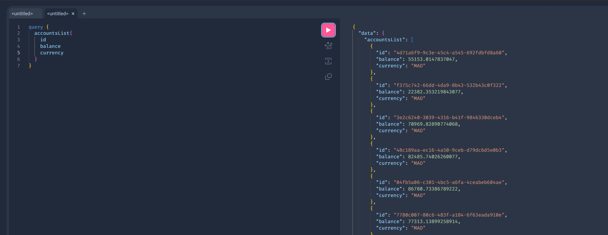

*Figure 6 - Liste des comptes avec solde et devise.*

#### Consultation d'un compte par identifiant

```graphql
query {
  bankAccountById(id: "ae8e54ec-58d8-4549-b780-3fff8a56ae33") {
    currency, balance
  }
}
```

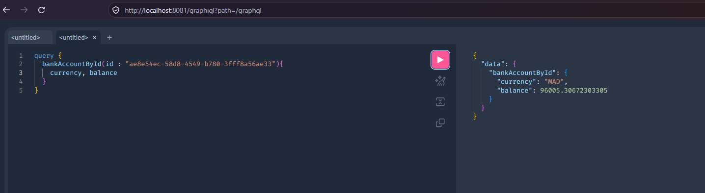

*Figure 7 - Consultation d'un compte par son identifiant.*

#### Comptes avec leur client

```graphql
query {
  accountsList {
    id, balance, customer { name, bankAccounts { id } }
  }
}
```

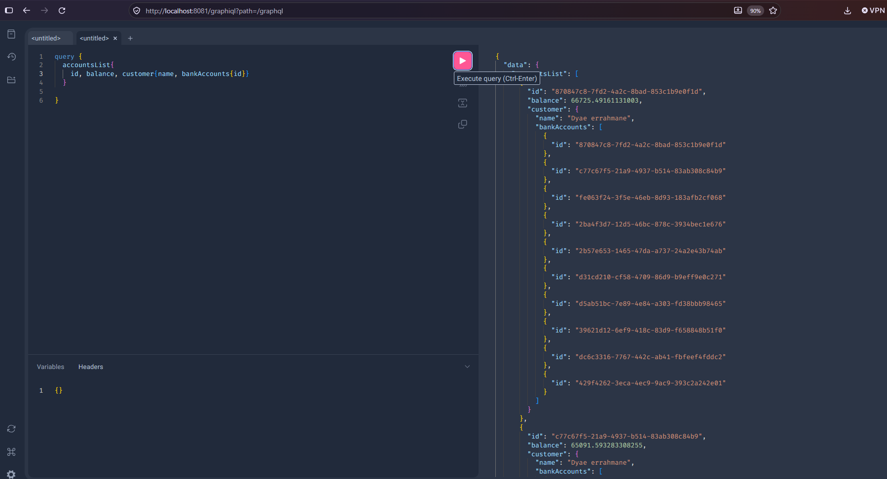

*Figure 8 - Comptes avec le client associé et la liste de ses comptes.*

#### Liste des clients

```graphql
query {
  customers {
    id, name
  }
}
```

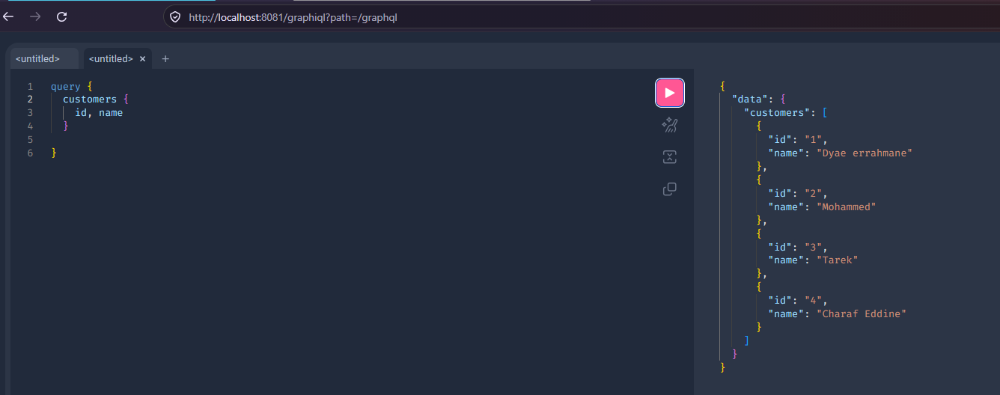

*Figure 9 - Liste des clients.*

#### Clients avec leurs comptes bancaires

```graphql
query {
  customers {
    id, name, bankAccounts {
      balance, id
    }
  }
}
```

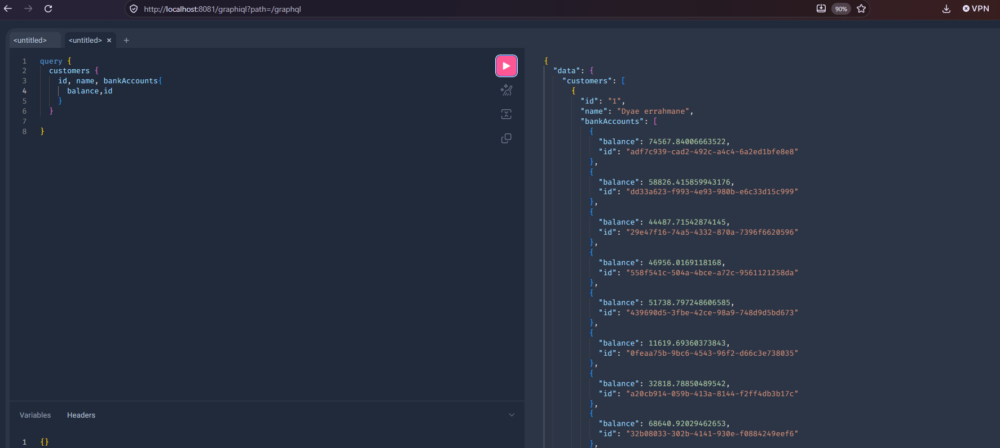

*Figure 10 - Clients avec leurs comptes bancaires.*

### 5.2 Mutations

#### Ajout d'un compte

```graphql
mutation {
  addAccount(bankAccount: {
    type: "SAVING_ACCOUNT",
    balance: 1254,
    currency: "USD"
  }) {
    id, type, balance
  }
}
```

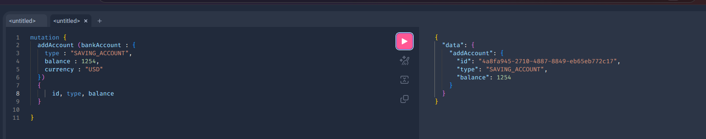

*Figure 11 - Création d'un compte d'épargne via GraphQL.*

#### Suppression d'un compte

```graphql
mutation {
  deleteAccount(id: "4a8fa945-2710-4887-8849-eb65eb772c17")
}
```

La mutation retourne `true` lorsque la suppression a réussi.

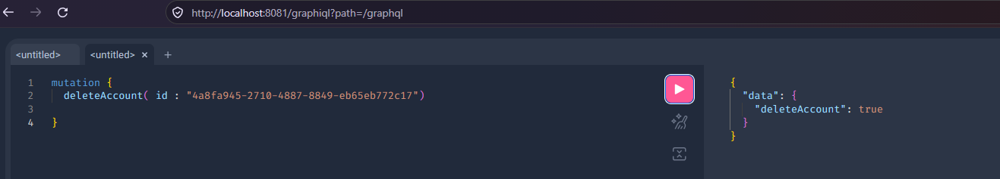

*Figure 12 - Suppression d'un compte via GraphQL.*

---

## Dyae errahmane Zouhari -- d3zy


